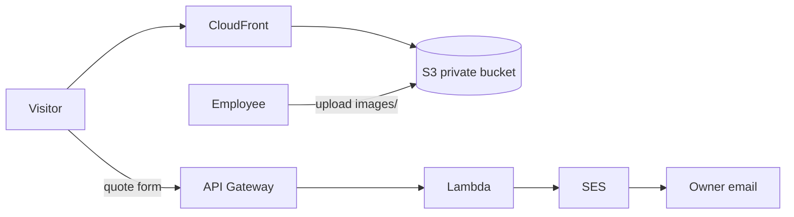

# VVS AWS Migration: case study

Moving a small plumbing firm's website from an office PC to AWS.

> **Note:** This is a design case study. I built and tested the EC2 and S3 parts in AWS Learner Lab. The full solution (CloudFront, form Lambda, SES) is a design, and the costs are estimates from the AWS Pricing Calculator, not a real bill.

## The problem

The firm (12 employees) runs its website on an office PC. After a power cut the site was down for two days. Nobody at the firm knows IT, and the budget is at most 300 SEK per month. The site has 5 text pages and 400 images (about 2 GB), roughly 3,000 visits per month mostly from the Mälardalen area, and a quote form (about 40 requests per month).

## Architecture

| Part | Service | Why | If removed |
| --- | --- | --- | --- |
| Site and images | S3 (private bucket) | Cheap, durable, no server to patch | No place to store the site |
| Delivery | CloudFront with Origin Access Control | HTTPS, caching, fast in Sweden, bucket stays private | The bucket would have to be public and there is no HTTPS on a custom domain |
| Contact form | API Gateway + Lambda | Static hosting cannot process forms; pay only per submission | The form cannot work |
| Email to owner | SES | Sends each request to the owner | The owner never sees requests |
| Employee uploads | IAM user limited to `images/` | One person can add images and nothing else | Uploading would need broader access |

## Key decisions

- **Hosting:** S3 + CloudFront, because there is no server that can go down in a power cut, nothing to patch, and the cost is very low.
- **Contact form:** API Gateway + Lambda + SES, because a static site cannot process a form and Lambda only costs money when someone submits.
- **Region:** Stockholm (eu-north-1). Visitors are nearby and the form holds personal data (GDPR). In my own test, the connection time from Sweden was 0.136 s to N. Virginia versus 0.033 s to Stockholm, about four times faster.
- **Access:** Visitors can read the site and submit the form. They cannot read the bucket directly or upload. One employee can upload and view files in `images/` only. The owner receives requests by email and needs no AWS access.

## Cost estimate (Stockholm)

Estimate from the AWS Pricing Calculator. The calculator does not include free-tier discounts, so the real bill is likely even lower.

| Item | Monthly cost |
| --- | --- |
| S3 (2 GB, Stockholm) | 0.06 USD |
| CloudFront (6 GB out, 30,000 requests, priced for Europe/Frankfurt) | 0.54 USD |
| API Gateway (HTTP API, about 1,000 requests) | 0.00 USD |
| Lambda (40 requests) | 0.00 USD |
| SES (40 emails) | 0.00 USD |
| **Total** | **0.60 USD per month (about 6 SEK)** |
| For comparison: one t3.micro EC2 instance running all month | about 7.88 USD (about 79 SEK) |

The total is far below the 300 SEK limit. The domain name (about 100 to 150 SEK per year if the firm wants one) is not included.

## Risks and mitigations

| Risk | Fix |
| --- | --- |
| Form spam or abuse | Hidden honeypot field, API Gateway throttling, validate and cap input length |
| Bucket accidentally made public | Keep Block Public Access on, only CloudFront can read (OAC), set a billing alert |
| Employee account stolen | Limited policy, MFA, access keys not shared |
| Personal data in emails | Collect only needed fields, delete old emails, state the purpose |
| Site down again | No server to fail; S3 and CloudFront are managed and replicated |

## What I built and learned

In AWS Learner Lab I built an EC2 web server and an S3 static site. I tested:

- **EC2 vs serverless:** an EC2 server runs and bills all the time and needs patching; Lambda runs only on requests.
- **Security groups:** why the page did not load until port 80 was allowed, and why SSH (port 22) should be limited to My IP. My SSH log showed an outside IP probing port 22 within hours.
- **S3 access models:** a public bucket policy compared with a private bucket and a presigned URL.
- **Region latency:** my own measurements, Virginia vs Stockholm (see Key decisions).

## Limitations

Learner Lab limits which regions and services I can use. I did not deploy CloudFront, the form Lambda or SES, so the full solution and its costs are a design and an estimate. What I did build and test is the EC2 server, security group, S3 bucket and the latency measurements.
